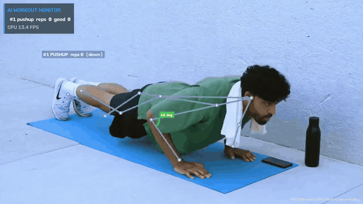
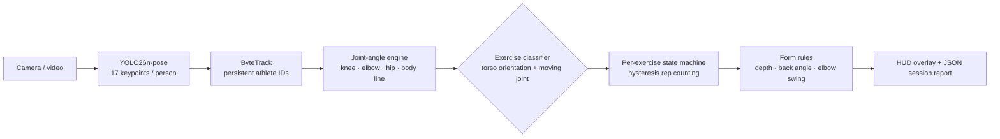

# 01 · AI Workout Monitor: Rep Counting & Form Feedback

> Multi-person exercise tracking with **YOLO26-pose**: the system recognizes the exercise automatically, counts reps, checks range of motion and gives live form cues. It runs in real time on a laptop **CPU** with no GPU.



▶ Full demo video: [`upwork_portfolio/01_workout_monitoring/demo.mp4`](../../upwork_portfolio/01_workout_monitoring/demo.mp4)

## The problem
Fitness apps, connected-gym equipment and physiotherapy clinics need to know **what** a person is doing, **how many** reps they completed and **whether the form is safe**, using only a single ordinary camera. Wearables are expensive and people forget them. Manual counting doesn't scale to group classes.

## Solution



| Component | What it does |
|---|---|
| **Pose estimation** | `yolo26n-pose` gives 17 COCO keypoints per person in a single pass, so cost doesn't grow with the number of people |
| **Tracking** | ByteTrack keeps a stable ID per athlete, so each person gets their own counter even in a group class |
| **Side selection** | Uses whichever body side the camera sees more confidently, so it works filmed from the left or the right |
| **Auto exercise detection** | Horizontal torso means push-up. Moving knee means squat. Moving elbow with static knees means bicep curl |
| **Rep state machine** | `up → down → up` with separate *partial* and *full-depth* thresholds and EMA smoothing, so noisy keypoints don't double count |
| **Form cues** | "Go deeper", "Lower your chest", "Keep body straight (hips)", "Chest up", "Pin elbows" |
| **Filtering** | Ignores mirror reflections and background people (relative-height filter) |

## Results on the demo clips

| Clip | Exercise detected | Reps counted | Full-range reps | Feedback raised | CPU FPS* |
|---|---|---|---|---|---|
| `pushups.mp4` (16 s) | push-up ✔ | 4 | 4 | none | 14.8 |
| `squats_home.mp4` (13 s) | squat ✔ | 7 | 7 | "Chest up" ×1 | 15.5 |
| `squats_gym.mp4` (coach + trainee) | squat ✔ (2 people) | 2 + 1 | 1 + 0 | "Go deeper" ×2 | 14.1 |

\*Intel i9-14900HX laptop CPU, 1280×720 input, end-to-end including tracking and rendering, **measured while two training jobs were running on the same CPU**.
In the gym clip, the mirror reflections of both people are correctly ignored.

Each run writes a session report (`outputs/<clip>.json`):
```json
{"track_id": 1, "exercise": "squat", "reps": 7, "full_range_reps": 7, "form_score": 100,
 "issues": {"Chest up - torso leaning": 1}}
```

## Run it
```bash
# from the repo root: ./setup.sh && python scripts/download_media.py --project 01_workout_monitoring
cd projects/01_workout_monitoring
python run.py --source data/pushups.mp4                  # auto-detect exercise
python run.py --source data/squats_gym.mp4 --exercise squat
python run.py --source 0 --show                          # live webcam
```

## Taking it to production
- **Edge / mobile:** `yolo26n-pose` exports to CoreML, TFLite and NCNN (`yolo export model=yolo26n-pose.pt format=tflite`) for on-device apps. Video never leaves the phone, which helps with privacy and GDPR.
- **More exercises:** each exercise is one rule entry (joint, thresholds, form checks). Lunges, deadlifts, overhead press and physio range-of-motion tests are config changes, not new models.
- **Data loop:** per-rep angle traces can be stored for coaching analytics, injury-risk scoring or training a sequence classifier (e.g. a GRU on keypoints) for complex movements.

## Business applications
Fitness and coaching apps · smart-mirror and connected-gym hardware · physiotherapy remote monitoring · corporate wellness · sports performance labs.

---
**Video credits:** demo clips are short excerpts of public YouTube videos (`TIHiJS_VV4Y` "Man doing pushups — free to use clip", `gmVDpETAEE4` squats stock preview, `8uoaYwS6iFM` IU Health "Squat (Bodyweight)"), used for non-commercial technical demonstration. Run `scripts/download_media.py` to fetch them.
