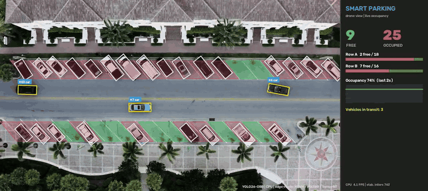
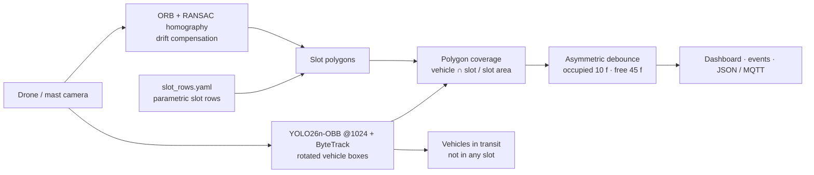

# 02 · Drone Smart Parking: Slot Occupancy from Aerial Video, Edge-Ready

> Parking-lot occupancy from a drone or high mast camera using **YOLO26-OBB** (oriented bounding boxes trained on aerial imagery). The system compensates for drone drift, debounces flickering detections, and exports to **Raspberry Pi (NCNN), the Raspberry Pi AI Camera (Sony IMX500) and NVIDIA Jetson (TensorRT)**.



▶ Full demo video: [`upwork_portfolio/02_drone_parking_edge/demo.mp4`](../../upwork_portfolio/02_drone_parking_edge/demo.mp4)

## The problem
Malls, airports, hospitals and municipalities want live "free spaces" counts and guidance signage, but in-ground sensors cost $200–400 per space and need trenching. A single drone pass, or a camera on a light mast, covers hundreds of spaces. Top-down vehicles are rotated and densely packed, though, which defeats normal axis-aligned detectors. Drones also drift, so slot maps fall out of alignment within seconds.

## Solution



| Design choice | Why it matters |
|---|---|
| **Oriented boxes (OBB)** | Angled parking and rotated cars produce tight polygons, so a car never "spills" into the neighbouring slot |
| **Parametric slot rows** | A whole row of angled spaces is 6 numbers (`x0, y_top, y_bottom, pitch, dx, count`). Irregular lots can use a polygon JSON instead |
| **Drift compensation** | ORB features matched to the reference frame plus a RANSAC homography warp the slot map every 3 frames (~750 inliers). Without it, misalignment caused **32 false slot events in 35 s; with it, 3** |
| **Asymmetric debounce** | A missed detection (dark car in shadow) is far more common than a phantom car, so "free" needs 1.5 s of evidence and "occupied" needs 0.3 s |
| **Coverage, not IoU** | Uses the fraction of the *slot* that's covered, which stays robust for vans bigger than the slot |

## Results

| Metric | Value |
|---|---|
| Slots monitored | 34 (2 rows of angled parking) |
| Vehicles detected per frame | ~28 (small + large vehicle) |
| Final occupancy | 26 / 34 (76 %) |
| Slot state changes in 35 s | 3 (A14 filled, A11 freed and re-filled when a dark car was briefly missed, absorbed by the debounce rule) |
| CPU throughput* | 5.5 FPS at imgsz 1024, including stabilisation, tracking and dashboard |

\*i9-14900HX laptop CPU, measured while two training jobs shared the CPU. A parking lot only needs **1 frame every few seconds**, so even a Raspberry Pi is more than enough.

### Edge export and benchmark
`export_edge.py` exports the model and benchmarks every format that runs on this machine:

<!-- EDGE_TABLE -->

| Target device | Format | How |
|---|---|---|
| Raspberry Pi 4/5 (CPU) | **NCNN** | `python export_edge.py --formats ncnn` then `run.py --model ../../models/yolo26n-obb_ncnn_model` |
| Raspberry Pi AI Camera | **IMX500** (INT8, on-sensor NPU) | `python export_edge.py --imx`; deploy the packaged `.rpk` with `picamera2` |
| NVIDIA Jetson Orin / Nano | **TensorRT** FP16 | on the Jetson: `yolo export model=yolo26n-obb.pt format=engine half=True` |
| Intel NUC / IPC | **OpenVINO** | `python export_edge.py --formats openvino` |

YOLO26 is **NMS-free end-to-end**, so the exported graph has no custom post-processing ops. That's exactly what makes it easy to run on NPUs like the IMX500.

## Run it
```bash
cd projects/02_drone_parking_edge
python run.py --source data/parking_drone.mp4 --slots slot_rows.yaml
python export_edge.py --formats onnx ncnn openvino --imgsz 640 1024
```
Event payload (what an edge device would publish to `parking/<lot_id>/status`):
```json
{"slots": 34, "occupied_final": 26, "avg_occupancy_pct": 75.5,
 "events": [{"slot": "A14", "status": "occupied", "t": 8.58}]}
```

## Taking it to production
- **Drone missions:** a fixed waypoint and altitude per pass plus the stored reference frame. The homography handles residual GPS error, and a geo-referenced orthomosaic links slots to lat/lon.
- **Fixed cameras:** the same code with `--no-stabilize` runs 24/7 on a Pi 5 or Jetson at the pole and pushes only JSON (a few bytes per minute) over LTE.
- **Analytics:** occupancy heat-maps per hour, dwell time per slot, overstay and illegal parking alerts, EV-bay misuse.

## Business applications
Smart-city parking guidance · malls and airports · hospital campuses · fleet yards and car dealerships (inventory counting) · event venues · port and logistics yard management.

---
**Video credit:** "Top view footage of the parking lot" (YouTube `FO8IF1Swcv4`), short excerpt for non-commercial technical demonstration.
