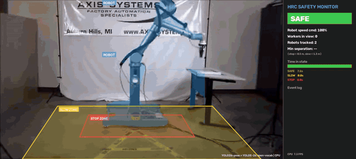
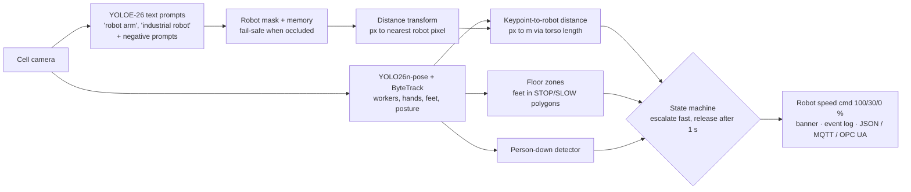

# 05 · Robot Cell Safety Monitor: Human-Robot Separation with Pose Estimation

> As factories and warehouses add more robots, people and machines increasingly share the same floor. This project watches a robot work cell with one camera. It finds **workers (YOLO26-pose)** and **robots (YOLOE-26 open-vocabulary segmentation, no robot dataset needed)**, measures how close every body part gets to the robot, and issues **SAFE / SLOW / STOP** speed commands in the style of ISO/TS 15066 speed-and-separation monitoring.



▶ Full demo video: [`upwork_portfolio/05_robot_cell_safety/demo.mp4`](../../upwork_portfolio/05_robot_cell_safety/demo.mp4)

## The problem
Collaborative robots (cobots), AMRs and humanoids are moving out of fenced cages. Safety-rated laser scanners only see a 2-D slice at ankle height. They don't know whether a *hand* is reaching into the workspace, they can't tell a person from a pallet, and they produce no analytics. Plant managers also want to know **how often** and **where** people come close to robots, so they can redesign layouts before an accident happens.

## Solution



| Capability | How |
|---|---|
| **No robot training data** | YOLOE-26 segments robots from **text prompts** (`"robot arm"`, `"collaborative robot"`). Negative prompts (`"person"`, `"table"`) stop it from labelling people as robots |
| **Fail-safe occlusion handling** | When a worker blocks the camera's view of the robot, the last known robot mask is kept for 6 s, so the robot is never "forgotten" |
| **Hand-level separation** | The minimum distance from *any* of 12 body keypoints, wrists included, to the robot mask, converted to metres using the worker's own torso as a scale reference |
| **Floor zones** | Configurable polygons, like tape or laser-scanner fields. Feet inside them trigger SLOW or STOP |
| **Hysteresis** | Escalation is immediate. De-escalation needs 1 s of a calmer state, so the robot doesn't stutter |
| **Person-down alarm** | Wide bounding box plus horizontal torso triggers an emergency STOP and alert |
| **Analytics** | Time in each state, minimum separation, number of stops, timestamped event log |

## Results

| Clip | Workers | Robots | SAFE / SLOW / STOP time | Protective stops | CPU FPS* |
|---|---|---|---|---|---|
| UR10 cell with floor zones (40 s) | 1 | 1 (UR10) | 11.3 s / 4.8 s / 23.9 s | 2 | 9.4 |
| Cobot assembly line (28 s, handheld camera) | 2–3 | 2–3 cobots | 1.6 s / 0.6 s / 25.8 s | 3 | 9.3 |

\*i9-14900HX laptop CPU running two models per frame (pose every frame, YOLOE every 3rd frame), measured while training jobs shared the CPU.

**How to read the results.** In the UR10 clip the operator walks up to the robot, works next to it and leaves. The monitor goes SAFE → STOP → SLOW → STOP → SAFE and logs each transition. In the cobot-line clip, operators deliberately work *hand-in-hand* with the arms, so the monitor spends most of the time in STOP. That's the intended behaviour for an **audit of close-contact events**. A real deployment on that line would use cobot power-and-force-limiting thresholds instead.

Event log example (`outputs/ur10_safety_zone.json`), ready to publish to a PLC, MES or MQTT broker:
```json
{"t": 9.04,  "from": "SAFE", "to": "STOP", "people": 1, "min_separation_m": 0.45}
{"t": 24.12, "from": "STOP", "to": "SLOW", "people": 1, "min_separation_m": 0.8}
{"t": 28.93, "from": "SLOW", "to": "STOP", "people": 1, "min_separation_m": 0.4}
{"t": 37.74, "from": "STOP", "to": "SAFE", "people": 0, "min_separation_m": null}
```

## Run it
```bash
cd projects/05_robot_cell_safety
python run.py --source data/ur10_safety_zone.mp4 --cell ur10_cell.yaml
python run.py --source data/cobot_assembly_line.mp4 --cell cobot_line.yaml --robot-memory 1.0
python run.py --source rtsp://cell-cam-01/stream --cell my_cell.yaml --show
```
A new cell is just a YAML file: robot prompts, distance thresholds, floor-zone polygons and speed percentages.

## Taking it to production
- **Disclaimer:** this is a decision-support and analytics layer. It is **not** a certified safety function. Actual machine guarding must use PLd/SIL2-rated devices. The vision layer adds hand-level awareness, analytics and layout insights on top.
- **Better distances:** calibrate the camera (homography to the floor) or use a stereo or ToF camera for true 3-D separation. Use two cameras to remove the monocular depth ambiguity.
- **Robot state input:** read the robot's real speed and pose (UR RTDE, ABB EGM, ROS 2) to compute ISO/TS 15066 protective separation distance dynamically.
- **Integration:** state changes map directly to a digital output, OPC UA node or ROS 2 topic (`/safety/speed_scaling`).
- **Custom robots:** if text prompts aren't enough (unusual end-effectors, AMRs, humanoids), fine-tune `yolo26n-seg` on about 300 labelled frames with the `common/train.py` pipeline used in projects 03 and 04.

## Business applications
Cobot cells · AMR and forklift–pedestrian interaction in warehouses · humanoid robot pilots · near-miss analytics for EHS teams · layout optimisation · insurance and compliance reporting.

---
**Video credits:** short excerpts of public YouTube videos, "Safety Zone Demo on the Next Generation UR10" (Axis Systems, `-9-KgZXAPq0`) and "Home Appliance Assembly | Collaborative Robots" (EVS, `u-LbWc0TQcU`), used for non-commercial technical demonstration.
